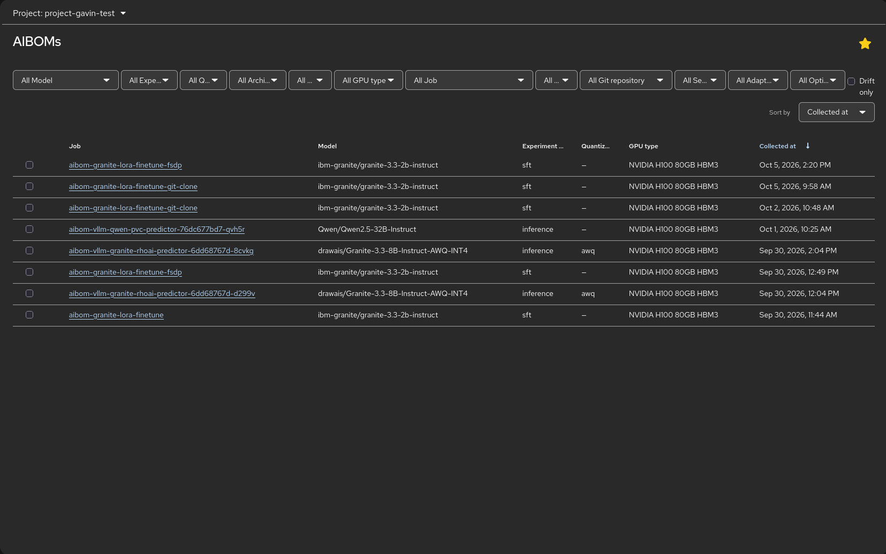
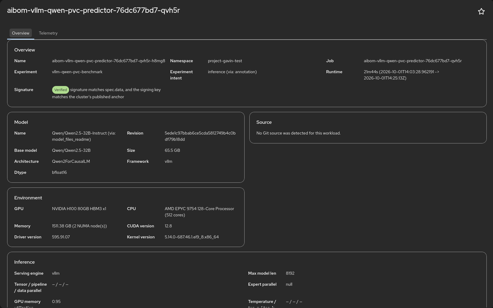
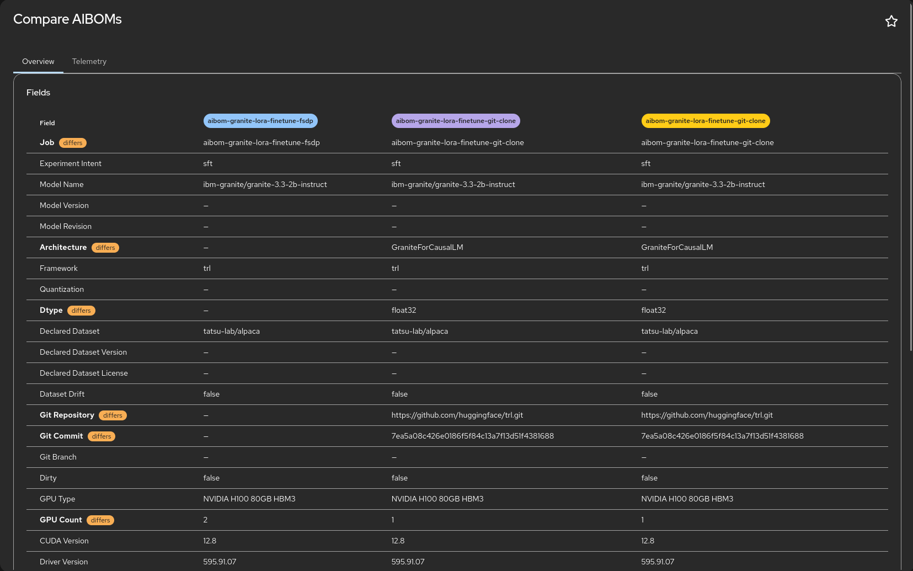
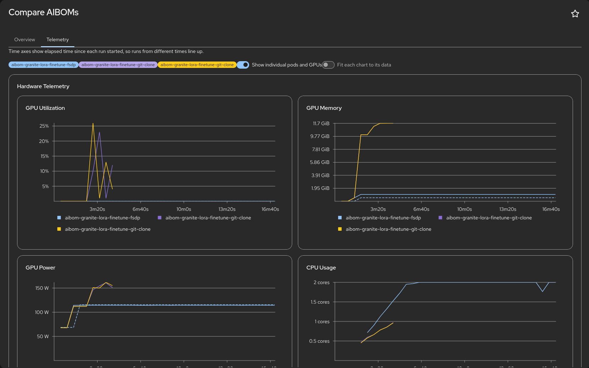

# AIBOM Console Plugin

An OpenShift Console dynamic plugin for browsing and filtering `aibom.io/v1alpha1` `AIBOM` custom resources, produced by [`aibom-webhook-service`](https://github.com/gavinsan33/aibom-webhook-service).

It runs inside the OpenShift web console itself, so it inherits the logged-in user's OAuth token and existing RBAC on `aiboms.aibom.io`. There is no separate login or auth system.

For a terminal-based alternative with the same filter, sort and compare capabilities, see [`oc-aibom`](https://github.com/gavinsan33/oc-aibom), the `kubectl`/`oc` plugin that this plugin's List view mirrors.

## Features

- **List view:** filter and sort AIBOMs across a namespace or all projects, mirroring `oc aibom list`.
- **Detail view:** full field breakdown covering model, dataset, environment and performance tables, mirroring `oc aibom describe`.
- **Compare view:** side-by-side comparison of two or more AIBOMs with hardware and inference metrics and delta calculations.
- **Telemetry tabs** (Detail and Compare): charts for GPU, CPU, memory, network and inference (vLLM) metrics, drawn from the time series the webhook stores with each AIBOM at collection time. They outlive Prometheus's retention window. AIBOMs created before that was stored have no charts.
- **CSV export:** download a summary or the full telemetry of the selected AIBOMs. Off by default; enable it with `plugin.featureFlags.csvExport` (see [Deployment](guide/deployment.md#feature-flags)).

## Screenshots

**List view:** filter and sort AIBOMs, select rows to compare.

**Detail view:** model, source, environment and inference fields, with signature status.

**Compare view:** fields side by side, with differing rows flagged.

**Compare telemetry:** runs overlaid on elapsed time so they line up.

## Where to go next

- [Prerequisites](guide/prerequisites.md)
- [Deployment](guide/deployment.md)
- [Development](guide/development.md)
